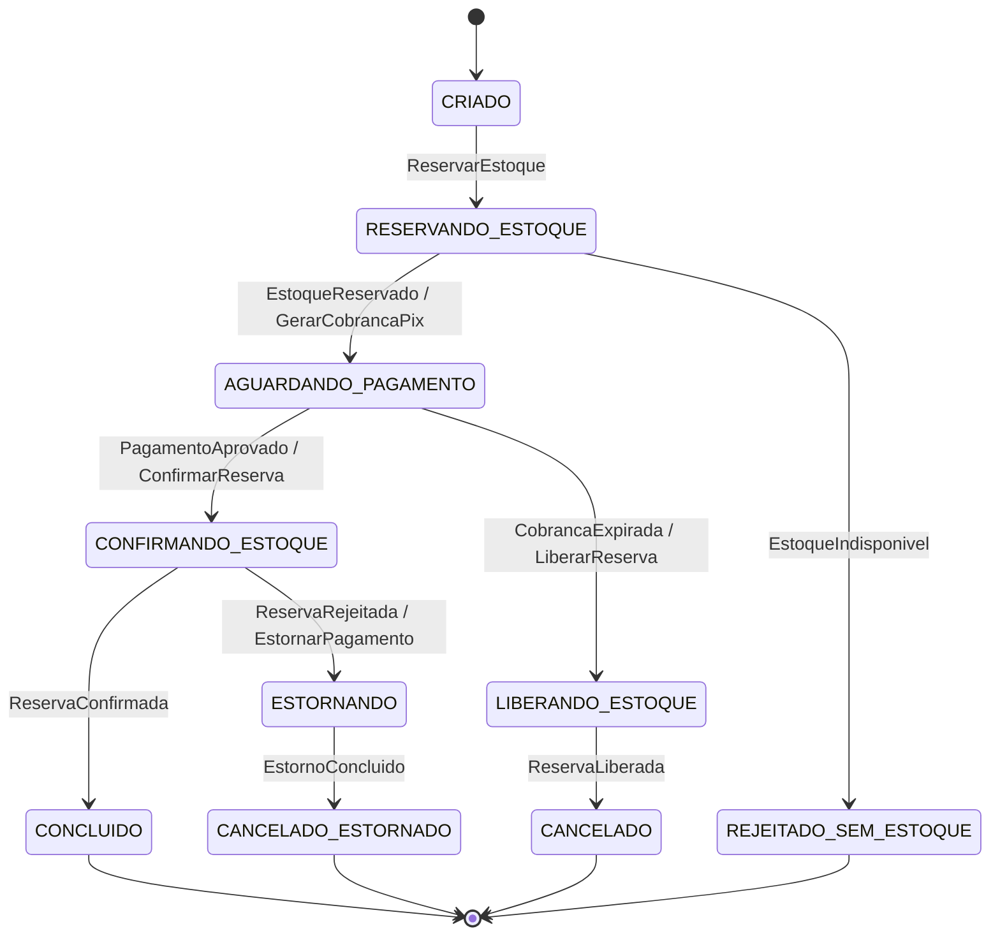

# Template de System Design: Aula 04 - Microsserviços & Padrão Saga

> **Contexto do Cenário: O Pedido Pago Sem Produto na Black Friday**
>
> Sua equipe está arquitetando a transação distribuída de compra na Black Friday para o marketplace:
>
> 1. **O Incidente:** Um cliente comprou uma Smart TV de R$ 3.000 via Pix. O gateway de pagamentos debitou o valor imediatamente e confirmou a transação. No milissegundo seguinte, o serviço de Estoque esgotou as unidades e rejeitou a reserva. O dinheiro sumiu da conta do cliente, o produto não existe para entrega e o pedido travou em um estado inconsistente.
> 2. **O Desafio Distribuído:** Não existe transação única (`@Transactional`) entre bancos de dados autônomos de Checkout, Pagamento e Estoque.
> 3. **A Carga:** 5.000 TPS de checkout simultâneo e milhões de clientes consultando o status da compra em "Meus Pedidos".
>
> **Instruções:** Responda às decisões arquiteturais abaixo fundamentando suas escolhas estritamente com base nos requisitos e restrições deste cenário. Documente suas decisões no repositório contínuo do seu projeto através de commits atômicos e bem descritivos.

---

## 1. Transações Distribuídas: Coordenação e Trade-offs

### 1.1 Volumetria e Pragmatismo: 2PC vs Saga

- **Análise Crítica:** Em quais cenários arquiteturais uma transação ACID local ou Two-Phase Commit (2PC) resolveria o problema com menor custo operacional? Por que, para o cenário de 5.000 TPS na Black Friday com serviços e bancos autônomos, o 2PC é inviável e a consistência eventual se torna necessária?
  > **Onde ACID local ou 2PC resolvem com menor custo:**
  > - **Transação ACID local:** quando os dados que precisam mudar juntos estão **no mesmo banco**, como num monólito modular ou num único serviço dono de pedido, pagamento e estoque. Um `@Transactional` garante a atomicidade sem compensação, sem broker e sem estados intermediários. É a opção mais barata sempre que a fronteira dos dados permite.
  > - **2PC:** quando há poucos participantes **sob o mesmo controle**, todos com suporte a XA (por exemplo, um banco relacional e uma fila JMS no mesmo servidor de aplicação), com volume baixo e transações curtas: back-office, conciliações internas, rotinas batch. Nesse cenário, o custo do 2PC (duas rodadas de rede, locks durante a votação, um coordenador) é aceitável e o código fica simples.
  >
  > **Por que o 2PC é inviável neste cenário:**
  > 1. **O pagamento não participa de 2PC.** O Pix é liquidado pelo PSP, fora do nosso controle. Não existe "preparar" um Pix e depois desfazê-lo: depois do débito, o único caminho de volta é uma **devolução**, que é uma nova operação. O 2PC não consegue incluir justamente o passo mais crítico do fluxo.
  > 2. **Bancos autônomos.** Checkout, Pagamento e Estoque têm bancos próprios, possivelmente de tecnologias diferentes, e o broker de mensagens (Kafka) não é um recurso XA. Exigir XA de todos acoplaria a tecnologia e o ritmo de cada time.
  > 3. **Locks e contenção a 5.000 TPS.** No 2PC, cada participante segura os locks do *prepare* até o *commit*, atravessando a rede. Na Black Friday, a linha de estoque de um produto em promoção (a Smart TV) vira um ponto quente. Se cada transação segurar o lock dessa linha por ~50 ms, ela processa no máximo ~20 compras por segundo, seja qual for o tamanho do cluster (conta ilustrativa).
  > 4. **Protocolo bloqueante e disponibilidade.** Se o coordenador cair entre as fases, os participantes ficam "em dúvida", com os locks presos até ele voltar. Além disso, a disponibilidade do checkout vira o produto das disponibilidades: três serviços com 99,9% cada resultam em ~99,7%, e qualquer participante lento deixa todos lentos.
  >
  > **Conclusão:** trocamos a atomicidade imediata por **consistência eventual com convergência garantida**. Cada serviço faz commit local do seu passo, e a Saga garante que o pedido sempre termine num estado final coerente: concluído, ou cancelado com o dinheiro devolvido, por meio de ações compensatórias. O preço dessa troca são estados intermediários visíveis ("pagamento em processamento"), tratados nas seções 2 e 3.

### 1.2 O Modelo de Coordenação da Saga

- **A Escolha:** ( ) Coreografia (Orientada a Eventos)  (X) Orquestração (Process Manager / Máquina de Estados)
- **Justificativa e Mitigação das Desvantagens do seu Modelo:**
  - *Se você escolheu Coreografia:* Como seu design resolve a falta de visibilidade centralizada (saber em tempo real onde o pedido está) e previne dependências cíclicas à medida que novos serviços entrarem no fluxo de compra?
  - *Se você escolheu Orquestração:* Qual componente atua como Orquestrador, como ele se comunica com os participantes (síncrono ou assíncrono) e como você evita que ele se transforme em um "serviço Deus", tirando a inteligência e a autonomia dos outros microsserviços?
  > **Por que orquestração:** o fluxo de compra tem um passo irreversível (o Pix) e uma compensação que envolve dinheiro. Precisamos saber, a qualquer momento, em que passo cada pedido está e quem decide estornar. Com orquestração, a máquina de estados fica explícita num só lugar: o status de "Meus Pedidos" vem dela, e o suporte responde "onde está meu pedido?" sem juntar logs de três serviços. Na coreografia, essa visão teria de ser reconstruída a partir de eventos espalhados, e a regra "pagou sem estoque → estorna" ficaria implícita entre serviços.
  >
  > **Quem é o orquestrador:** um componente `PedidoSaga` (process manager) **dentro do serviço de Checkout/Pedidos**, que já é o dono do pedido. Não é um serviço novo: é o dono do agregado Pedido coordenando o ciclo de vida do próprio pedido. Cada instância da saga é persistida na tabela `saga_pedido` (estado atual, versão, prazo do próximo passo), então um restart não perde nenhuma saga em andamento.
  >
  > **Comunicação assíncrona**, via Kafka, com tópicos de comando e de resposta por participante (`estoque.comandos` / `estoque.respostas`, `pagamento.comandos` / `pagamento.respostas`) e a chave da mensagem igual ao `pedidoId`:
  > - A 5.000 TPS, chamadas HTTP síncronas encadeadas somariam latências e disponibilidades e prenderiam recursos esperando o participante mais lento. Com o broker, um participante lento ou fora do ar acumula mensagens na fila em vez de derrubar o checkout, e volta a consumir quando se recupera.
  > - O cliente não espera a saga terminar: o `POST /pedidos` responde `202 Accepted` com o `pedidoId` e o status atual.
  >
  > **Como evitar o "serviço Deus":**
  > - **O orquestrador só sequencia.** Ele sabe *qual* é o próximo passo diante de uma resposta, não *como* executá-lo. Envia comandos de intenção (`ReservarEstoque`, `GerarCobrancaPix`, `ConfirmarReserva`, `EstornarPagamento`) e reage a respostas de negócio (`EstoqueReservado`, `EstoqueIndisponivel`, `PagamentoAprovado`, `ReservaRejeitada`).
  > - **As regras ficam com os donos.** O Estoque decide se há unidades, como reservar e quando a reserva expira. O Pagamento fala com o PSP e cuida de retries, idempotência e devoluções. O orquestrador nunca acessa o banco de outro serviço nem replica regras dos participantes.
  > - **Contratos versionados:** os schemas de comandos e respostas ficam num schema registry, para que cada serviço evolua de forma independente.
  > - **Escopo limitado:** um orquestrador por processo de negócio. Outros fluxos (troca, devolução de produto) ganham sagas próprias, em vez de engordar um orquestrador central.

---

## 2. Máquina de Estados, Compensação e Confiabilidade

### 2.1 Máquina de Estados e Fluxos Ponta a Ponta

- **Estados do Pedido:** Defina a máquina de estados explícita do ciclo de vida da transação no seu modelo (incluindo os estados iniciais, intermediários, de compensação e finais).
  > **Decisão que ataca a causa do incidente: reservar o estoque *antes* de cobrar.** No incidente, o passo irreversível (o Pix) aconteceu antes do passo que podia falhar (o estoque). Na nossa saga, os passos seguem a classificação clássica:
  > - **Reserva de estoque — compensável:** pode ser desfeita liberando a reserva, sem custo para o cliente.
  > - **Pagamento Pix — passo pivô:** depois dele, a saga precisa seguir em frente ou devolver o dinheiro.
  > - **Confirmação da reserva — repetível:** é retentada até ter resposta definitiva.
  >
  > A reserva tem TTL de 15 minutos e a cobrança Pix expira em 10 minutos. Assim, um Pix pago normalmente sempre encontra a reserva viva. Os prazos são ilustrativos.
  >
  > | Estado | Tipo | Significado |
  > |---|---|---|
  > | `CRIADO` | inicial | Pedido gravado e saga iniciada |
  > | `RESERVANDO_ESTOQUE` | intermediário | Comando `ReservarEstoque` enviado |
  > | `AGUARDANDO_PAGAMENTO` | intermediário | Estoque reservado, cobrança Pix gerada, QR code na tela |
  > | `CONFIRMANDO_ESTOQUE` | intermediário | Pix aprovado; comando `ConfirmarReserva` enviado (baixa definitiva) |
  > | `CONCLUIDO` | final (sucesso) | Estoque baixado; pedido segue para faturamento e entrega |
  > | `REJEITADO_SEM_ESTOQUE` | final | Não havia unidade para reservar; nada foi cobrado |
  > | `LIBERANDO_ESTOQUE` | compensação | Pix expirou sem pagamento; comando `LiberarReserva` enviado |
  > | `CANCELADO` | final | Reserva liberada; nada foi cobrado |
  > | `ESTORNANDO` | compensação | Pago, mas sem produto; `EstornarPagamento` enviado e repetido até a confirmação |
  > | `CANCELADO_ESTORNADO` | final | Devolução do Pix confirmada pelo PSP |
  >
  > O evento `CobrancaExpirada` só é emitido pelo Pagamento depois de confirmar no PSP que a cobrança venceu sem pagamento. Uma cobrança vencida não pode mais ser paga, então não existe corrida entre "liberar o estoque" e "o Pix entrar".



- **Detalhamento dos Fluxos:**
  - **Caminho Feliz:** Descreva o fluxo de ponta a ponta da transação concluída com sucesso entre Checkout, Pagamento e Estoque.
  - **Caminho de Falha & Compensação:** Descreva o passo a passo a partir da falha na reserva de estoque após o pagamento aprovado. Como a ação compensatória (estorno) é disparada e executada sem intervenção humana?
  > **Caminho feliz:**
  > 1. **Checkout:** o cliente confirma a compra. O Checkout valida o carrinho e, numa única transação local, grava o pedido `CRIADO`, a instância da saga e o comando `ReservarEstoque` na outbox. Responde `202` com o `pedidoId`.
  > 2. **Estoque — reserva:** consome o comando e faz um decremento condicional (`UPDATE estoque SET disponivel = disponivel - 1, reservado = reservado + 1 WHERE sku = ? AND disponivel >= 1`). Grava a reserva com expiração e responde `EstoqueReservado`.
  > 3. **Pagamento — cobrança:** o orquestrador muda para `AGUARDANDO_PAGAMENTO` e envia `GerarCobrancaPix`. O Pagamento cria a cobrança no PSP com `txid` derivado do pedido e expiração de 10 minutos, e responde `CobrancaGerada` com o QR code, que vai para a tela do cliente.
  > 4. **Pagamento — confirmação:** o cliente paga. O PSP avisa o Pagamento por webhook; o Pagamento confere a cobrança no PSP (valor e `txid`) e responde `PagamentoAprovado`, com o identificador da transação Pix (`e2eid`).
  > 5. **Estoque — baixa:** o orquestrador muda para `CONFIRMANDO_ESTOQUE` e envia `ConfirmarReserva`. O Estoque transforma a reserva em baixa definitiva e responde `ReservaConfirmada`.
  > 6. **Conclusão:** o pedido vira `CONCLUIDO`, e o evento `PedidoConcluido` segue para faturamento, logística e notificação do cliente.
  >
  > **Caminho de falha e compensação (estoque falha depois do Pix aprovado):** com a reserva antes da cobrança, esse caso fica raro, mas continua possível. Exemplos: um atraso no processamento do pico faz a reserva expirar e a unidade é vendida para outro cliente, ou um ajuste de inventário (produto avariado, divergência com outro canal de venda) zera o saldo. O passo a passo:
  > 1. Em `CONFIRMANDO_ESTOQUE`, o Estoque responde `ReservaRejeitada` (motivo: sem saldo).
  > 2. Numa única transação local, o orquestrador muda o pedido para `ESTORNANDO`, grava na outbox o comando `EstornarPagamento` (pedido, `e2eid`, valor de R$ 3.000,00 e um `devolucaoId` determinístico derivado do pedido) e registra o prazo para a resposta.
  > 3. O Pagamento consome o comando e solicita a devolução ao PSP (`PUT /pix/{e2eid}/devolucao/{id}`), usando esse `devolucaoId`.
  > 4. O PSP confirma a devolução, na resposta ou por webhook, e o Pagamento responde `EstornoConcluido`.
  > 5. O orquestrador muda para `CANCELADO_ESTORNADO` e publica `PedidoCancelado`. O cliente é notificado ("compra cancelada por falta de estoque; R$ 3.000,00 devolvidos via Pix") e "Meus Pedidos" é atualizado.
  >
  > **Sem intervenção humana:** a decisão de estornar é uma transição da máquina de estados, disparada pela resposta do Estoque, e a execução fica com o Pagamento. Se o Estoque não responder ao `ConfirmarReserva`, o orquestrador reenvia o comando quando o prazo vence. É seguro, porque o comando é idempotente, e a saga nunca fica parada num estado intermediário.

### 2.2 Resiliência da Compensação e Consistência

- **E se a compensação falhar ou oscilar?** A chamada ou evento de estorno pode sofrer timeout ou instabilidade transitória. Como seu design garante que o cliente não fique no prejuízo se a tentativa de compensação falhar ou for reprocessada?
  > O estorno é tratado como um passo que **não pode falhar definitivamente**: ele é repetido até o PSP confirmar, e cada repetição é segura.
  >
  > - **Idempotência ponta a ponta:**
  >   - O comando `EstornarPagamento` leva um `devolucaoId` determinístico, derivado do pedido, e não um identificador novo a cada tentativa.
  >   - O Pagamento grava a devolução na tabela `devolucoes` (chave única por pedido), com status `SOLICITADA`, **antes** de chamar o PSP.
  >   - Na API Pix, o `id` da devolução é definido por quem a solicita e não pode ser reutilizado para o mesmo Pix: uma segunda requisição com o mesmo `id` é recusada. Por isso, numa repetição, o Pagamento primeiro consulta a devolução (`GET /pix/{e2eid}/devolucao/{id}`) e, se ela já existe, só reaproveita o resultado.
  >   - Rede de segurança: o PSP recusa devoluções cuja soma ultrapasse o valor do Pix original, então nem um bug devolve R$ 6.000.
  > - **Timeout não é falha:** se a chamada ao PSP estourar o tempo, o resultado é desconhecido. A devolução continua `SOLICITADA` e a próxima tentativa começa pela consulta. Nunca se registra "estorno falhou" só porque a resposta não chegou.
  > - **Retry persistente:** backoff exponencial com jitter (1 s, 2 s, 4 s... até 5 minutos entre tentativas), sem limite de tentativas enquanto o pedido estiver em `ESTORNANDO`. Um circuit breaker protege o PSP: se ele estiver fora do ar, as tentativas esperam em vez de martelá-lo, e o comando continua guardado no Kafka e no banco, sem se perder.
  > - **Prazos da saga:** o orquestrador grava um prazo para cada comando enviado. Um job encontra sagas em `ESTORNANDO` sem resposta dentro do prazo e reenvia o comando, o que é seguro graças à idempotência. Como o estado está no banco, um restart do orquestrador retoma todas as sagas de onde pararam.
  > - **Conciliação com o PSP como fonte da verdade:** um job periódico cruza Pix recebidos, pedidos concluídos e devoluções confirmadas. Qualquer Pix pago sem pedido concluído e sem devolução gera um `EstornarPagamento` automático. O webhook de devolução do PSP também fecha a saga, mesmo que a resposta síncrona tenha se perdido.
  > - **Escalonamento sem abandono:** se um pedido passar do SLA em `ESTORNANDO` (por exemplo, 30 minutos), um alerta vai para o time de plantão e o cliente vê "devolução em processamento", mas as tentativas automáticas continuam. A intervenção humana é uma exceção monitorada, não parte do fluxo. A janela regulatória, de até 90 dias após o Pix original para a devolução, fica muito acima desse SLA.
- **Atomicidade entre Estado e Mensageria (Dual Write):** Se a sua arquitetura envolve publicação de eventos ou mensagens entre passos, como você garante que a persistência no banco local e o despacho da mensagem ocorram sem risco de perda silenciosa se a rede ou o broker falharem entre as duas operações?
  > **Transactional Outbox em todos os serviços.**
  > - Nenhum serviço publica direto no Kafka dentro da lógica de negócio. A mudança de estado e a mensagem são gravadas **na mesma transação local**: a linha do pedido (ou da saga) e uma linha na tabela `outbox`. Ou as duas são gravadas, ou nenhuma.
  > - Um relay publica a outbox no Kafka. A opção recomendada é CDC com Debezium lendo o log do banco (o WAL do PostgreSQL) com o Outbox Event Router; a alternativa mais simples é um poller que lê as linhas ainda não publicadas. Se o broker ou a rede caírem, as linhas esperam na tabela e são publicadas quando a conexão voltar. Nada se perde em silêncio.
  > - O relay garante **entrega pelo menos uma vez**, ou seja, pode duplicar mensagens depois de uma falha. Por isso, todo consumidor é idempotente: a tabela `mensagens_processadas` (inbox) tem chave única no `messageId` e é gravada na mesma transação do efeito. Uma mensagem repetida é descartada.
  > - **Ordenação:** a chave da mensagem é o `pedidoId`, então todas as mensagens de um pedido caem na mesma partição e são consumidas em ordem. Além disso, a máquina de estados ignora transições inválidas, como um `EstoqueReservado` atrasado para um pedido já cancelado.
  > - O offset do Kafka só é confirmado depois do commit no banco.
  >
  > ```java
  > @Transactional
  > public void aoReceber(ReservaRejeitada msg) {
  >     if (!inbox.registrarSeNova(msg.messageId())) return;   // mensagem duplicada
  >     var saga = sagas.buscar(msg.pedidoId());
  >     saga.transicionarPara(ESTORNANDO);                     // valida a transição
  >     outbox.adicionar("pagamento.comandos", saga.pedidoId(),
  >         new EstornarPagamento(saga.pedidoId(), saga.e2eId(), saga.valor(), saga.devolucaoId()));
  > }   // um único commit: inbox + estado + outbox
  > ```

---

## 3. Desacoplamento com CQRS e Estratégia de Testes

### 3.1 Consultas em Alta Vazão com CQRS

- **O Problema de Leitura:** Durante o pico de vendas, milhões de usuários atualizam a página de "Meus Pedidos" a cada poucos segundos.
- **Desenho da Solução:** Como você separa a responsabilidade de escrita (Command) da consulta de status (Query)? Como o modelo de leitura é alimentado e como sua arquitetura lida com a consistência eventual (o delay entre o pagamento e a visualização do status)?
  > **Separação entre escrita e leitura:**
  > - **Command:** o serviço de Checkout/Pedidos recebe o `POST /pedidos`, executa a saga e grava no banco transacional (PostgreSQL), modelado para consistência: pedido, itens, saga e outbox. Nenhuma tela de consulta lê desse banco.
  > - **Query:** um serviço de consulta (`pedidos-query`) atende o `GET /meus-pedidos` a partir de um modelo de leitura desnormalizado, já no formato da tela. É um documento por pedido, particionado por `clienteId`, com o status de exibição, itens, valor, datas e a versão do pedido. Fica num banco feito para leitura por chave com escala horizontal (como DynamoDB ou Cassandra), com cache Redis na frente para os pedidos em andamento.
  > - Assim, o pico de leitura nunca disputa recursos com os 5.000 TPS de escrita, e cada lado escala separadamente. A ordem de grandeza justifica a separação: 2 milhões de clientes atualizando a cada 5 segundos geram 400 mil leituras por segundo, cerca de 80 vezes o volume de escrita (conta ilustrativa). Para reduzir esse volume, as respostas usam `ETag` (o navegador recebe `304 Not Modified` quando nada mudou) e o cliente espaça as consultas quando o pedido não está mudando.
  >
  > **Como o modelo de leitura é alimentado:**
  > - Um projetor consome os eventos de domínio que já saem pela outbox (`PedidoCriado`, `PagamentoAprovado`, `PedidoConcluido`, `PedidoCancelado`, `EstornoConcluido`) e atualiza o documento do pedido.
  > - A gravação é idempotente e condicionada à versão: cada evento traz a versão do pedido, e o projetor só grava se ela for maior que a do documento. Um evento repetido ou atrasado nunca faz o status regredir.
  > - O modelo de leitura é descartável: pode ser reconstruído reprocessando os eventos, o que permite mudar o formato da tela ou corrigir um bug de projeção sem tocar no lado de escrita.
  >
  > **Como lidamos com a consistência eventual:**
  > - **Status honestos:** a tela mostra o estado intermediário em linguagem do cliente: "Aguardando pagamento", "Pagamento recebido, confirmando estoque", "Devolução em processamento", "Cancelado: R$ 3.000,00 devolvidos via Pix". Nunca aparece "Confirmado" antes de `CONCLUIDO`.
  > - **Ler o que acabou de escrever:** a resposta do `POST /pedidos` já traz o pedido com status e versão. O frontend guarda essa versão e, se o modelo de leitura ainda estiver atrás, continua mostrando o status mais novo que conhece (ou "atualizando...") em vez de voltar no tempo.
  > - **Push na tela do QR code:** a confirmação do Pix chega por Server-Sent Events assim que o `PagamentoAprovado` é projetado, então o cliente não precisa ficar atualizando a página.
  > - **Atraso monitorado:** a métrica de lag do projetor (tempo entre o evento e a projeção) tem SLO (por exemplo, p99 abaixo de 2 segundos) e alerta.
  > - **A leitura nunca decide nada:** estorno, reenvio de comandos e conciliação usam o lado de escrita e o PSP, nunca o modelo de leitura.

### 3.2 Estratégia de Testes da Transação Distribuída

- **Validação de Resiliência:** Como comprovar em ambiente de testes e pipeline que a Saga funciona de verdade?
- **Plano de Testes:** Descreva como você estruturaria o teste automatizado para simular a rejeição na reserva de estoque após a cobrança e validar que a compensação automática transiciona o pedido para cancelado com sucesso.
  > **Camadas de teste:**
  > 1. **Unitário (máquina de estados e orquestrador):** testes parametrizados de todas as transições, válidas e inválidas, e de "dada esta resposta neste estado, qual comando sai". Rodam em milissegundos, em todo build.
  > 2. **Contrato:** contratos dos comandos e respostas (Spring Cloud Contract ou Pact para mensagens), garantindo que o orquestrador e os participantes usam o mesmo schema.
  > 3. **Integração da saga (o teste principal):** com Testcontainers, sobem Kafka e PostgreSQL reais e o serviço de Checkout de verdade. O WireMock substitui o PSP do Pix, e o Estoque roda como container real ou como stub de mensagens configurado para rejeitar.
  > 4. **Caos e carga em homologação:** Toxiproxy e Chaos Monkey, combinados com k6 a 5.000 TPS, e uma verificação de invariantes no final.
  >
  > **Plano do teste "estoque rejeita depois da cobrança":**
  > - **Preparação:** o stub do Estoque responde `ReservaRejeitada` ao `ConfirmarReserva`, simulando que a reserva expirou e a unidade foi vendida. O WireMock do PSP aceita a devolução e informa o status `DEVOLVIDO`.
  > - **Ação:** criar o pedido, esperar `AGUARDANDO_PAGAMENTO` e simular o webhook do PSP informando o Pix de R$ 3.000,00 pago.
  > - **Verificações (com Awaitility, sem `sleep`):**
  >   - o pedido chega a `CANCELADO_ESTORNADO` em até 30 segundos;
  >   - o PSP recebeu **exatamente uma** devolução, de R$ 3.000,00, com o `devolucaoId` do pedido;
  >   - os eventos saíram na ordem `PagamentoAprovado → ReservaRejeitada → EstornarPagamento → EstornoConcluido → PedidoCancelado`;
  >   - nenhuma baixa de estoque foi registrada para o pedido;
  >   - o modelo de leitura mostra o pedido como cancelado com valor devolvido.
  >
  > ```java
  > @SpringBootTest
  > @Testcontainers
  > class SagaEstornoAutomaticoIT {
  >
  >     @Container @ServiceConnection
  >     static KafkaContainer kafka = new KafkaContainer("apache/kafka:3.8.0");
  >     @Container @ServiceConnection
  >     static PostgreSQLContainer<?> postgres = new PostgreSQLContainer<>("postgres:16");
  >     @RegisterExtension
  >     static WireMockExtension psp = WireMockExtension.newInstance()
  >         .options(wireMockConfig().dynamicPort()).build();
  >
  >     @Test
  >     void estoqueRejeitadoDepoisDoPixAprovadoEstornaECancelaOPedido() {
  >         estoqueStub.responderAoConfirmarReserva(ReservaRejeitada.semSaldo());
  >         psp.stubFor(put(urlPathMatching("/pix/.+/devolucao/.+"))
  >             .willReturn(created().withBody("{\"status\":\"EM_PROCESSAMENTO\"}")));
  >         psp.stubFor(get(urlPathMatching("/pix/.+/devolucao/.+"))
  >             .willReturn(okJson("{\"status\":\"DEVOLVIDO\"}")));
  >
  >         var pedidoId = checkout.criarPedido(SMART_TV, new BigDecimal("3000.00"));
  >         await().until(() -> pedidos.status(pedidoId) == AGUARDANDO_PAGAMENTO);
  >         pspWebhook.simularPixPago(pedidoId, new BigDecimal("3000.00"));
  >
  >         await().atMost(Duration.ofSeconds(30))
  >             .until(() -> pedidos.status(pedidoId) == CANCELADO_ESTORNADO);
  >         psp.verify(1, putRequestedFor(urlPathMatching("/pix/.+/devolucao/" + devolucaoId(pedidoId)))
  >             .withRequestBody(matchingJsonPath("$.valor", equalTo("3000.00"))));
  >         assertThat(estoque.baixasDoPedido(pedidoId)).isEmpty();
  >     }
  > }
  > ```
  >
  > **Variações que provam a resiliência (mesma estrutura de teste):**
  > - **PSP instável:** um cenário do WireMock responde `503`, depois timeout, depois `201` na devolução. O pedido termina `CANCELADO_ESTORNADO` com uma única devolução efetivada.
  > - **Mensagem duplicada:** `ReservaRejeitada` é entregue duas vezes, e só uma devolução é solicitada.
  > - **Orquestrador reiniciado no meio:** o serviço é derrubado e reiniciado com o pedido em `ESTORNANDO`. A saga retoma pelo prazo vencido e conclui.
  > - **Broker fora depois do commit:** o Toxiproxy corta o Kafka logo após a transição para `ESTORNANDO`. Quando a conexão volta, a outbox publica o comando e a saga conclui.
  > - **Webhook do PSP perdido:** sem nenhuma resposta, a conciliação encontra o Pix pago sem pedido concluído e dispara o estorno.
  >
  > **No pipeline:** testes unitários e de contrato a cada commit; testes de integração com Testcontainers em todo pull request, bloqueando o merge; testes de caos e de carga toda noite e antes da Black Friday, em homologação. O critério de aceite do teste de carga é um invariante financeiro: ao final, todo Pix aprovado corresponde a um pedido `CONCLUIDO` ou a uma devolução confirmada. Nenhum pedido termina pago sem produto.
